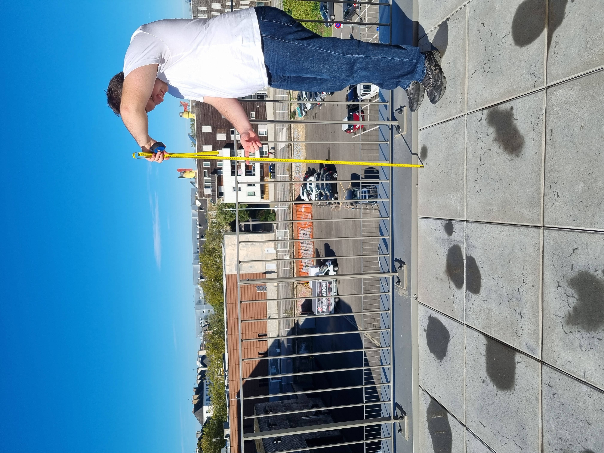

<h1 style=align="center">OLSK Large CNC V3</h1>

<h1 style=align="center">fait par l'équipe de M.Hulot le 01/01/2000</h1>

<i>Open Source CNC Milling machine - Large version - Open Lab Starter Kit</i>

 

Introduction
--
ceci est un test pour le repo de l'epf, haaaaaaaaaaaaaaaaaaaaaaaaaaaaaaaaaaaaaaaaaheeeeeeeeeeeeeeeeeeeeeeeeeeeeeeeeeeeeee ----------------------.

The Assembly Manual
--

All OLSK machines are open source and have an assembly manual, the BOM and necessary files available in this repository for replication. The assembly manual is an interactive 3D guide through each step and contains a list of parts, tools and instruction remarks, which follows a logical order to provide a smooth assembly.

- **[Assembly Manual](https://open-lab-starter-kit.github.io/OLSK-Large-CNC/)**

Specifications V3
--

- milling area: 2500 x 1250 mm
- frame: aluminum square beams with resign joints
- housing: fully enclosed with 3 accessible sides (liftable windows with gas spring)
- motion: ball screws on all axis with rotating nuts on the Y axis
- motors: closed-loop AC servo motors
- homing with inductive sensors
- industrial electronic system
- safe power setup with contactors, residual current device and circuit breakers
- tool changer (capacity: 14 tools)
- pneumatic coupling
- spindle: 4.5 Kw Spindle
- automatic tool sensor
- automatic tool cleaner
- automatic coolant
- automatic dust cover deploy
- mounted touchscreen
- software: OLOS
- WiFi and Ethernet connectivity
- 24V emergency stop

Files
--

- **[Settings](settings)**
- **[Firmware](firmware)**
- **[BOM](OLSK_Large_CNC_V3-BOM.xlsx)**
- **[Wiring Schematic](OLSK_Large_CNC_WiringSchematic_V3.pdf)**
- **[Pneumatics Schematic](OLSK_Large_CNC_PneumaticsSchematic_V3.pdf)**

Author
--

OLSK Large CNC has been designed and built by **[InMachines Ingrassia GmbH](https://www.inmachines.net/)**.

 

Machine design:
- **[Daniele Ingrassia](https://www.linkedin.com/in/danieleingrassia/)**

The machine is part of the **[Open Lab Starter Kit (OLSK)](https://www.inmachines.net/open-lab-starter-kit)** group of open source digital fabrication machines.

OLSK is developed by **[InMachines Ingrassia GmbH](https://www.inmachines.net/)** for the **[Dtec project](https://dtecbw.de/home/forschung/hsu/projekt-fabcity)** at **[Fab City Hamburg](https://www.fabcity.hamburg/en/)**.

OLSK Partners:
  

Contact
--

- daniele@inmachines.net
- [https://www.inmachines.net/](https://www.inmachines.net/)

License
--

Hardware design, CAD and PCB files, BOM, settings and other technical or design files are released under the following license:

- CERN Open Hardware Licence Version 2 Weakly Reciprocal - **[CERN-OHL-W](LICENSE_CERN_OHL_W_V2.txt)**

Assembly manual, pictures, videos, presentations, description text and other type of media are released under the following license:

- Creative-Commons-Attribution-ShareAlike 4.0 International - **[CC BY-SA 4.0](LICENSE_CC_BY_SA_4.0.txt)**

Copyright
--

- Daniele Ingrassia, InMachines Ingrassia GmbH

- Tobias Redlich, Helmut-Schmidt-Universität/Universität der Bundeswehr Hamburg

Previous version
--

The previous versions of OLSK machines will always be available.

**[OLSK Large CNC V1 Repository](OLSK_Large_CNC_V1)**

